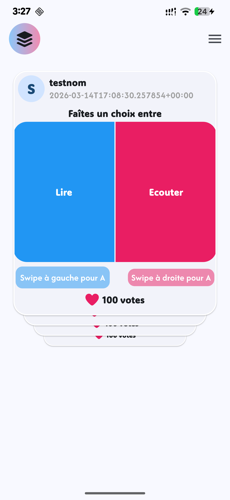
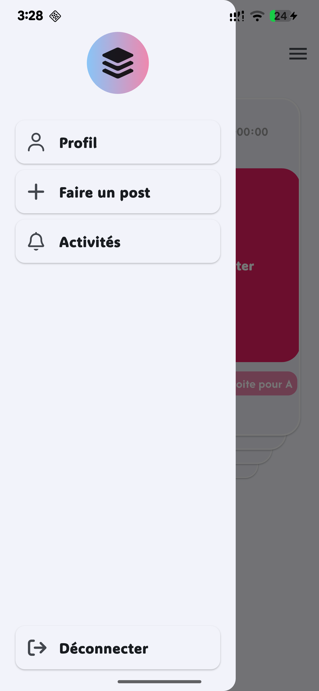
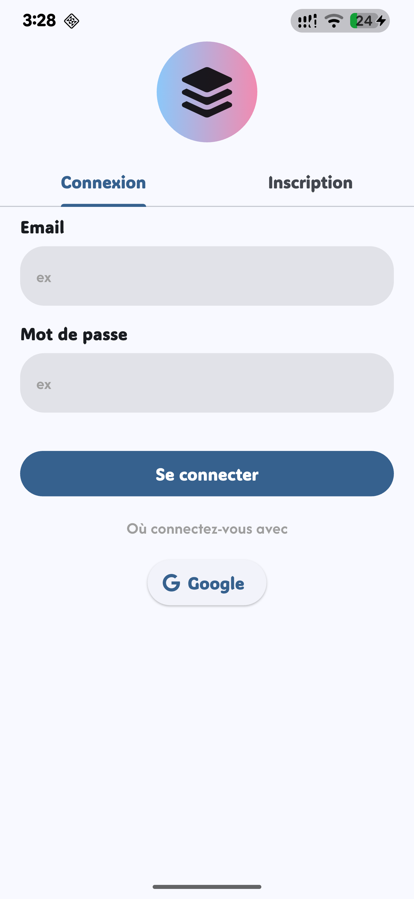
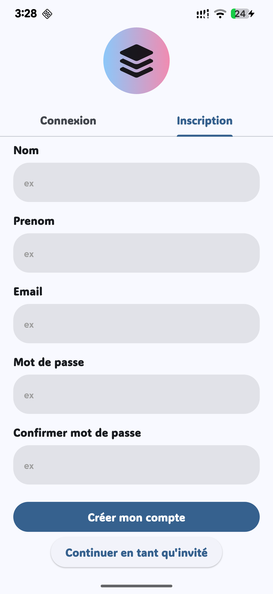
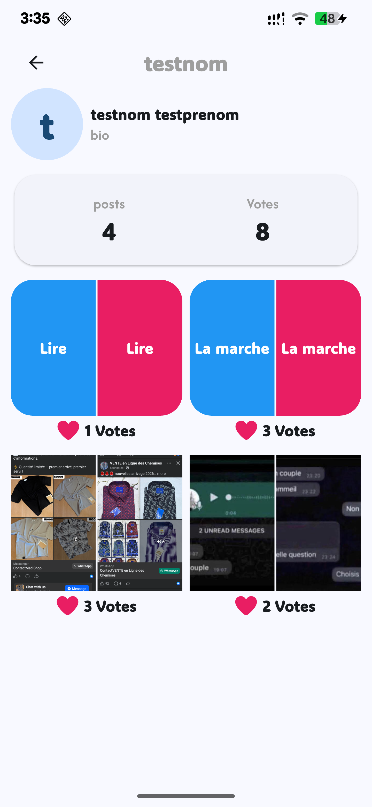
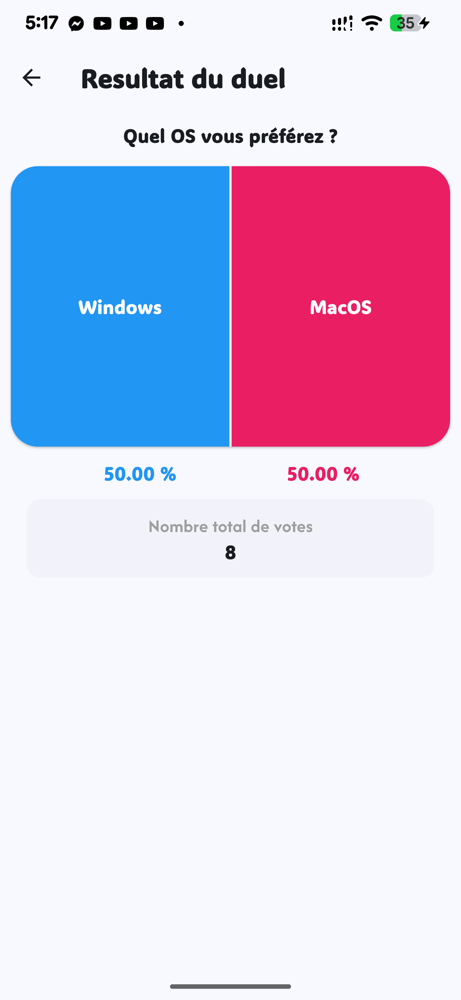

# Avis

**Application mobile de vote social par swipe — Flutter + Supabase**

[Live demo](https://avis-pp3j.vercel.app/)

[](https://github.com/Idjibo33/avis/actions/workflows/flutter.yml)

Avis est une application interactive conçue pour faciliter la prise de décision sociale. Les utilisateurs posent des questions sous forme de **duels** (texte contre texte, ou image contre image) et la communauté vote via une interface de swipe intuitive inspirée des applications de rencontre.

## Fonctionnalités

- **Authentification :** création de compte et connexion (Supabase Auth).
- **Création de duels :** questions textuelles ou visuelles (`image_picker` pour l'upload d'images).
- **Système de swipe :** vote sur les duels (`flutter_card_swiper`), enregistrement des interactions.
- **Flux temps réel :** affichage des posts et résultats mis à jour en direct (streams Supabase).
- **Page de profil :** posts publiés et interactions de l'utilisateur.
- **Statistiques d'un duel :** répartition des votes et résultat.
- **Sécurité :** politiques RLS (Row Level Security) configurées côté Supabase.

## Aperçu

| Accueil | Drawer | Auth | Auth | Profil | Résultat |
|---|---|---|---|---|---|
|  |  |  |  |  |  |

## Stack technique

| Domaine | Technologie |
|---|---|
| Framework | Flutter / Dart |
| Backend | Supabase — Auth, PostgreSQL, Storage |
| Gestion d'état | Provider (ChangeNotifier) |
| UI | `flutter_card_swiper`, `google_fonts`, `font_awesome_flutter`, `gap` |
| Configuration | Clés injectées au build via `--dart-define` (jamais commitées) |

## Architecture du projet

```
lib/
├── main.dart                 # Point d'entrée (injection des clés + Supabase.initialize)
├── auth_gate.dart            # Redirection selon l'état de connexion
├── Models/                   # Modèles de données (Post, Interaction, Profile)
├── Services/Supabase/        # Accès aux tables et au storage Supabase
├── Providers/                # État applicatif (Provider)
├── Screens/                  # Écrans : feed, auth, nouveau post, profil, résultat
├── Helpers/                  # Validation, navigation, formats, responsive
└── widgets/                  # Widgets partagés
```

## Base de données (Supabase)

| Objet | Rôle |
|---|---|
| `profiles` | Informations utilisateurs |
| `posts` | Contenu des duels (question, options, auteur) |
| `interactions` | Votes enregistrés |
| Vue `post_to_show` | Lecture optimisée du feed (stream) |

Les politiques RLS sont définies dans le dashboard Supabase (non versionnées dans ce dépôt).

## Installation

Prérequis : Flutter stable et un projet Supabase avec les tables ci-dessus.

```bash
flutter pub get

# 1. Créer le fichier .env à la racine à partir du modèle
cp .env.example .env
#    puis renseigner URL et ANONKEY (Supabase > Project Settings > API)

# 2. Lancer l'application en injectant les clés au build
flutter run --dart-define-from-file=.env

# Variante build web
flutter build web --dart-define=URL=<url> --dart-define=ANONKEY=<anonkey>
```

> Les clés sont lues avec `String.fromEnvironment` : aucun fichier de secrets n'est embarqué
> ni listé dans `pubspec.yaml`. Sans `--dart-define`, l'application compile mais ne peut pas
> joindre Supabase.

## Tests

```bash
flutter analyze
flutter test
```

Les tests couvrent les helpers (validation, pourcentage, format de date), les providers
(interactions) et les widgets/écrans principaux (auth, feed, résultat de duel, responsive).

## Prochaines étapes

- Nouveau design de la page feed.
- Tests widget de bout en bout sur le flux de vote.
- Versionnage du schéma SQL et des politiques RLS.

## Licence

[MIT](LICENSE)
