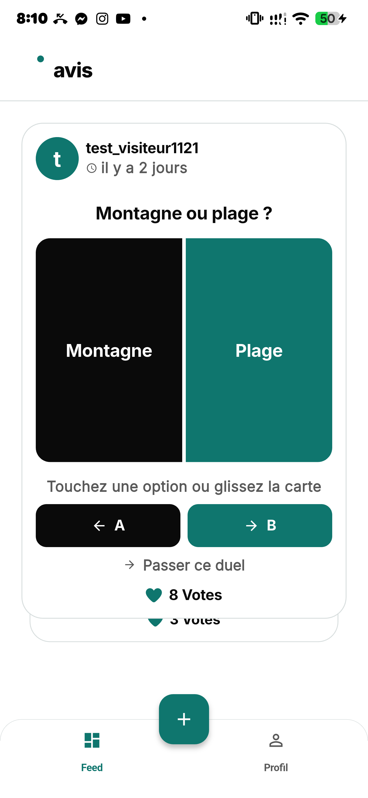
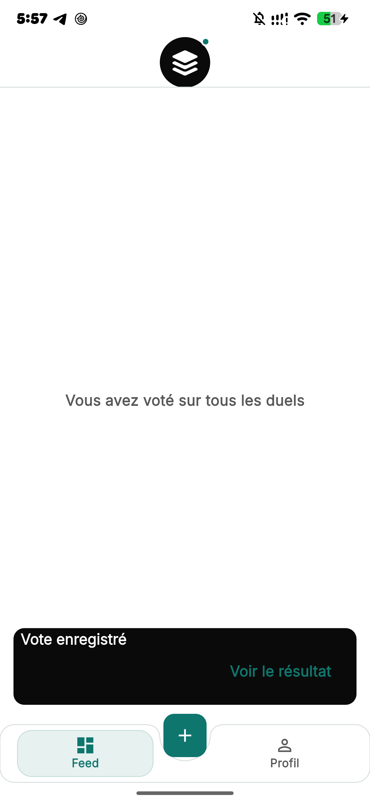
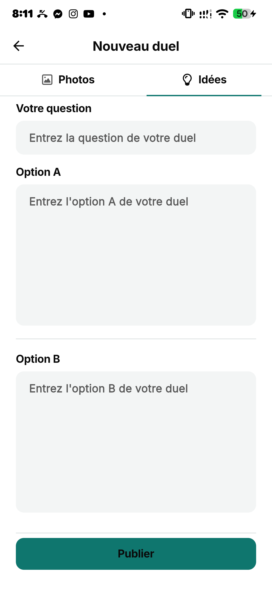
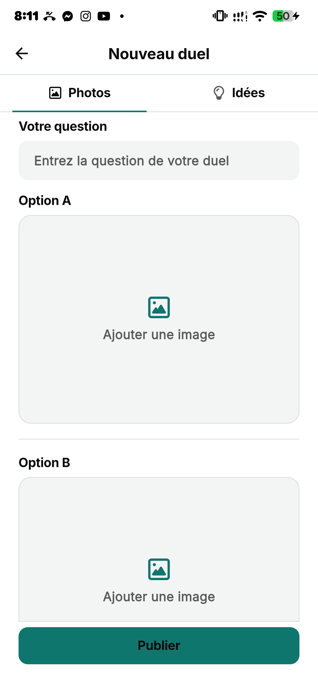
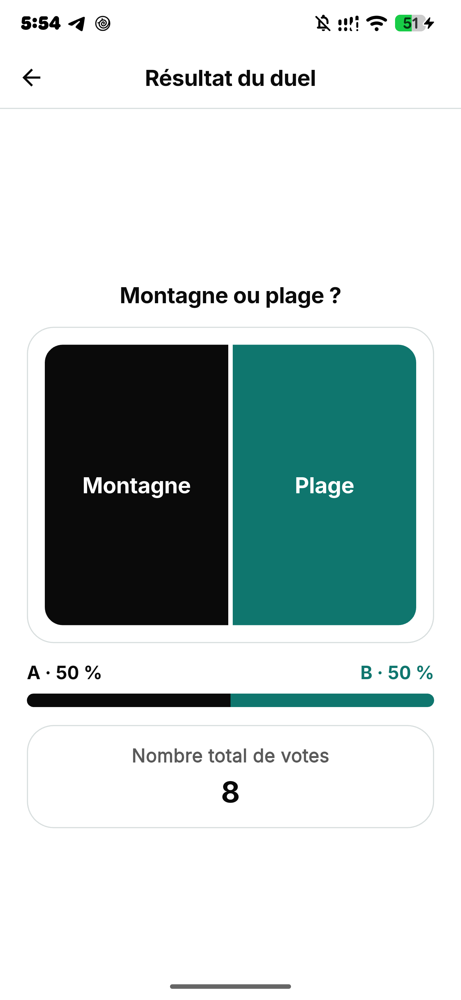
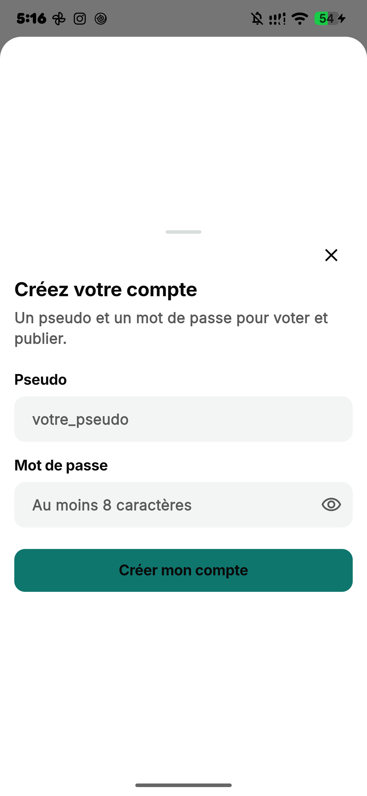
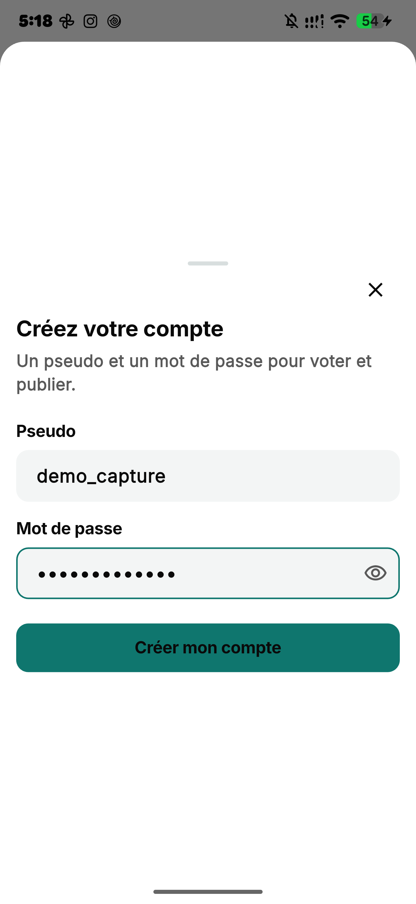
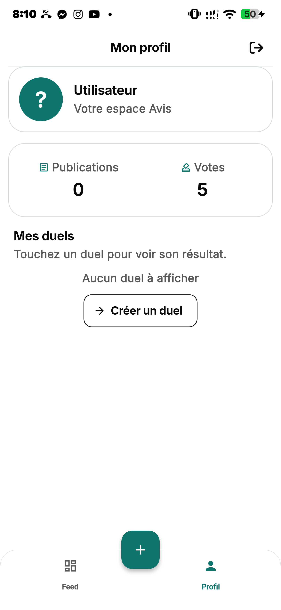

# Avis

**Application mobile de vote social par swipe — Flutter + Serverpod**

[Live demo](https://avis-pp3j.vercel.app/)

[](https://github.com/Idjibo33/avis/actions/workflows/flutter.yml)

Avis est une application interactive conçue pour faciliter la prise de décision sociale. Les utilisateurs posent des questions sous forme de **duels** (texte contre texte, ou image contre image) et la communauté vote via une interface de swipe intuitive inspirée des applications de rencontre.

## Fonctionnalités

- **Authentification :** démarrage en invité, élévation en une feuille modale avec pseudo (3–20 caractères) et mot de passe (8 caractères minimum). Pas d'email, ni de récupération de mot de passe.
- **Création de duels :** questions textuelles ou visuelles (`image_picker` pour l'upload d'images).
- **Système de swipe :** vote sur les duels (`flutter_card_swiper`), enregistrement des interactions.
- **Flux du feed :** duels lus depuis les endpoints publics Serverpod et exposés au client sous forme de stream, rafraîchi après chaque écriture.
- **Page de profil :** posts publiés et interactions de l'utilisateur.
- **Statistiques d'un duel :** répartition des votes et résultat.
- **Sécurité :** écritures derrière `requireLogin`, identité toujours dérivée de la session côté serveur ; aucun `userId` n'est accepté en paramètre.

## Aperçu

Captures du nouvel UI sur device (données de démonstration locales) :

| Feed | Tous les duels votés | Nouveau duel — Idées | Nouveau duel — Photos | Résultat |
|---|---|---|---|---|
|  |  |  |  |  |

| Élévation | Élévation — saisie | Profil — déconnexion |
|---|---|---|
|  |  |  |

## Stack technique

| Domaine | Technologie |
|---|---|
| Framework | Flutter / Dart |
| Backend | Serverpod 4.1.2 — serveur Dart, PostgreSQL, endpoints publics/authentifiés, client généré |
| Gestion d'état | Provider (ChangeNotifier) + états explicites (`lib/State/`) |
| UI | `flutter_card_swiper`, `google_fonts`, `font_awesome_flutter`, `gap` |
| Configuration | `SERVERPOD_URL` injectée au build via `--dart-define` (défaut `http://localhost:8080`) ; secrets serveur dans `passwords.yaml` (jamais commité) |
| Identité de l'app | `io.github.idjibo33.avis` : `applicationId` Android, `namespace` Kotlin et `PRODUCT_BUNDLE_IDENTIFIER` iOS |

## Architecture du projet

```
lib/
├── main.dart                 # Point d'entrée : crée le dépôt d'auth et injecte les providers
├── auth_gate.dart            # Feed en vue de départ + contrôleur d'élévation
├── Models/                   # Modèles de données (Post, Interaction, Profile)
├── Services/auth_repository.dart       # Contrat client : AuthSessionState / AuthRepository
├── Services/serverpod/                 # Adaptateurs du client généré (auth, duels, votes, profil, images)
├── Providers/                # État applicatif (Provider), dont AuthServicesProviders
├── State/                    # États explicites (OperationState, AuthGateViewState, élévation)
├── Screens/                  # Écrans : feed, feuille d'auth, nouveau post, profil, résultat
├── Helpers/                  # Validation, navigation (demanderElevation), formats, responsive
└── widgets/                  # Widgets partagés, dont le formulaire pseudo + mot de passe

serverpod/
├── avis_server/              # Serveur : endpoints, modèles *.spy.yaml, migrations, config
└── avis_client/              # Client Dart généré, dépendance path du projet Flutter
```

### Flux d'authentification

`AuthRepository` est la seule source de vérité de la session. `AuthGate` lit
`AuthSessionState` via `AuthServicesProviders` : `unknown` affiche un
chargement, `guest` et `authenticated` affichent directement le feed, `failed`
affiche un état d'erreur explicite quand aucune session invité n'existe.

L'élévation demande uniquement un **pseudo** et un **mot de passe** : il n'y a
ni email, ni vérification, ni récupération de mot de passe. Le compte anonyme
est élevé en conservant le même identifiant.

Au premier acte d'écriture (vote, publication, ouverture du formulaire),
`demanderElevation(context, action: ...)` ouvre la feuille `AuthenticationScreen`
si l'utilisateur est invité. Un échec annule l'action et conserve les saisies ;
un succès ferme la feuille et rejoue l'action une seule fois. La déconnexion se
fait depuis l'icône du trailing de l'app bar du profil et repasse en invité sans
écran de connexion.

`MainNavigationShell` porte un seul `Scaffold` pour les deux onglets principaux :
un `IndexedStack` garde le feed et le profil montés, et le `CupertinoTabBar`
aux couleurs du projet (Feed à gauche, Profil à droite, coins supérieurs
arrondis) change d'index sans `Navigator.push`. Le « + » teal est un
`FloatingActionButton` docké au centre de cette barre (même porte d'élévation),
pas un onglet. Le formulaire et le résultat restent de vraies routes poussées et
n'héritent pas de la barre. Sous chaque duel,
« Passer ce duel » retire la carte du tour courant sans vote écrit : elle revient
dès que les autres duels ont été vus, sans message ni compteur.

## Base de données (Serverpod)

| Table | Rôle |
|---|---|
| `username_account` | Pseudo et hachage Argon2id du mot de passe |
| `duel` | Contenu des duels (question, options, auteur) |
| `vote` | Votes enregistrés (index unique `duelId` + `userId`) |

Les modèles `*.spy.yaml` et les migrations sont versionnés dans
`serverpod/avis_server/` ; les lectures publiques et les écritures authentifiées
sont séparées en deux endpoints. Aucune politique RLS Supabase n'est impliquée.

## Installation

Prérequis : Flutter/Dart stable, Serverpod CLI 4.1.2, PostgreSQL et Redis (ou la base embarquée fournie par le CLI pour le développement).

```bash
# 1. Serveur : secrets, génération du client, migrations puis démarrage
cd serverpod/avis_server
cp config/passwords.yaml.example config/passwords.yaml  # à remplacer valeurs REPLACE_WITH_...
cd .. && dart pub get
cd avis_server && serverpod generate && serverpod create-migration
serverpod start                 # ou : dart run bin/main.dart

# 2. Client Flutter : adresse du serveur (défaut http://localhost:8080)
cd ../..
cp .env.example .env
#    renseigner uniquement SERVERPOD_URL ; les anciennes clés URL/ANONKEY sont ignorées
flutter pub get
flutter run --dart-define-from-file=.env

# Variante build web
flutter build web --dart-define=SERVERPOD_URL=<url>
```

> `SERVERPOD_URL` est lue avec `String.fromEnvironment` : aucun secret n'est embarqué
> dans l'application. Sans `--dart-define`, elle vaut `http://localhost:8080`.
> Les secrets du serveur restent dans `serverpod/avis_server/config/passwords.yaml` (gitignoré).

## Tests

```bash
flutter analyze
flutter test
```

Les tests couvrent les helpers (validation du pseudo et du mot de passe, pourcentage, format de date), les providers
(interactions, états d'authentification), les machines à états explicites (`lib/State/`, voir
[`docs/state-machines.md`](docs/state-machines.md)) et les widgets/écrans principaux (gate en invité,
feuille d'élévation, feed, résultat de duel, responsive). Le dépôt d'authentification est injecté
en fake dans les tests ; aucun service externe n'est nécessaire. Les écritures passent par `demanderElevation` et sont couvertes avec un `AuthRepository` fake.

## Branches

- `main` — **production** : ne reçoit que du code prêt à être déployé, via fusion de `develop`.
- `develop` — **développement** : branche d'intégration ciblée par toutes les Pull Requests.

Flux recommandé : `feature/*` ou `fix/*` → `develop` → `main`. La CI (analyse, tests, build web)
s'exécute sur les pushes et les Pull Requests des deux branches.

## Prochaines étapes

- Nouveau design de la page feed.
- Tests widget de bout en bout sur le flux de vote (invité → élévation → vote).
- Compléter les adaptateurs qui lèvent encore `UnimplementedError` (mise à jour d'un duel/vote, suppression d'image ou de profil).
- Migration des données historiques Supabase vers les tables Serverpod (hors dépôt).

## Licence

[MIT](LICENSE)
